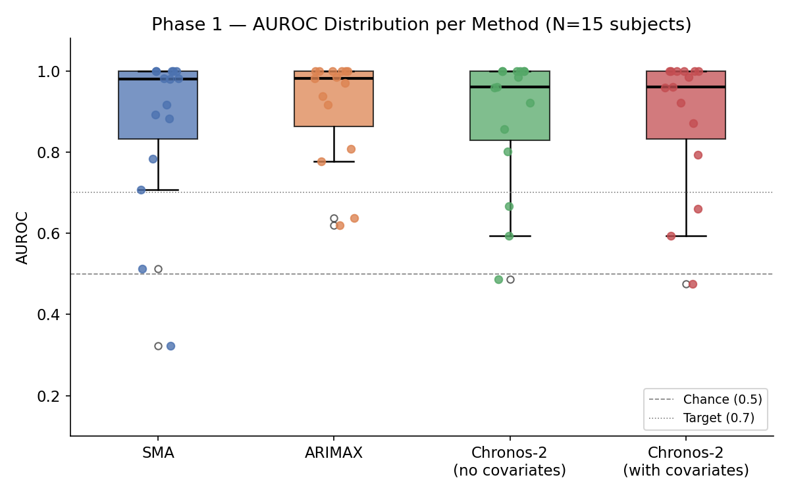
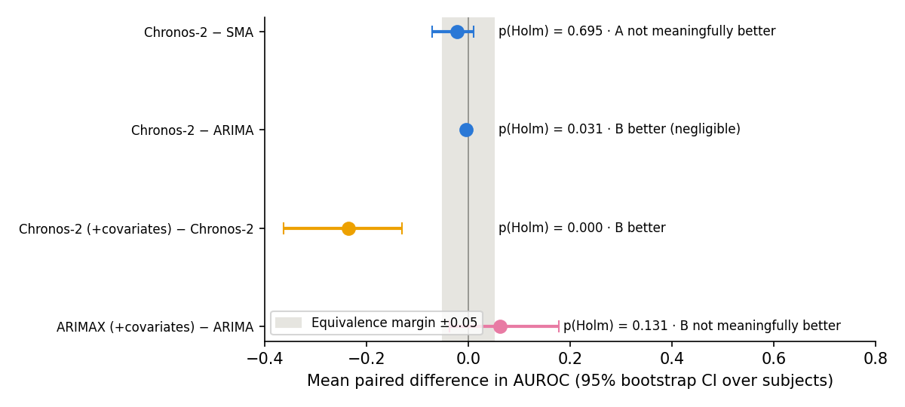
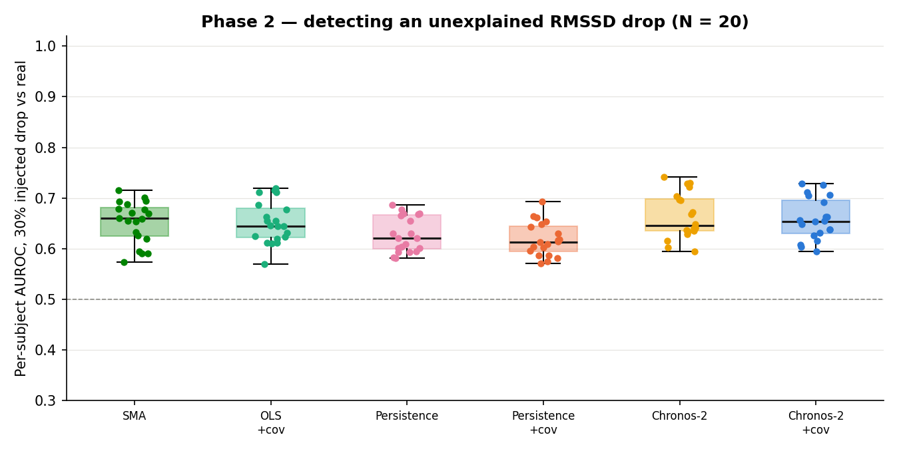

# chronos-health

Can Chronos-2, a pretrained time-series model, detect stress from heart-rate variability
(RMSSD) zero-shot, and do activity covariates help? It is compared with classical baselines
on WESAD (lab stress) and MMASH (24 h free living).

Each model forecasts a person's RMSSD from the recent past. The gap between the forecast and
what actually happened is the anomaly score, and AUROC measures how well that score finds
stress (0.5 = chance, 1.0 = perfect).

## Results

**Lab stress (WESAD, 15 subjects).** Every univariate model finds stress well (median AUROC
about 0.96), and Chronos-2 is no better than a simple moving average (SMA). Giving Chronos-2
activity covariates makes it much worse.



The paired differences make that explicit. Chronos-2 sits inside the ±0.05 "no real
difference" band against SMA and ARIMA, while covariates cost it about 0.24 AUROC: during
stress they move outside the range the model saw in its context.



**Free living (MMASH, 20 subjects).** With no stress labels, a 30% RMSSD drop is injected
into real data. Every model detects it only weakly (AUROC 0.61 to 0.66), and covariates
make no difference either way.



**Takeaway:** zero-shot Chronos-2 works as an anomaly scorer but beats nothing simple, and
context only helps when the model's context already contains the variation it must explain.
Full write-up in `report/report.pdf`.

## Run

Put the datasets in the repo root: [WESAD](https://ubi29.informatik.uni-siegen.de/usi/data_wesad.html)
as `WESAD/` and [MMASH](https://physionet.org/content/mmash/) as `DataPaper/`. Then:

```sh
uv sync
uv run python scripts/01_preprocess_wesad.py
uv run python scripts/02_preprocess_mmash.py
uv run python scripts/03_run_phase1.py    # WESAD evaluation
uv run python scripts/04_plot_phase1.py
uv run python scripts/04_run_phase2.py    # MMASH evaluation
uv run python scripts/05_plot_phase2.py
uv run --with pytest pytest
```

Results go to `results/`: CSVs, figures, and the write-ups `phase1_results.md` and
`phase2_results.md`.
